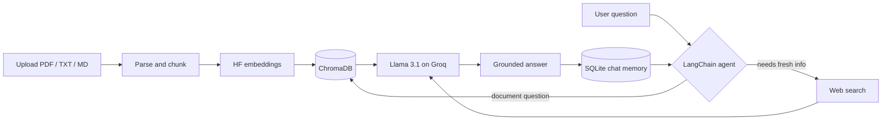
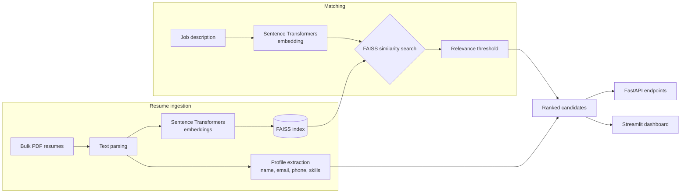
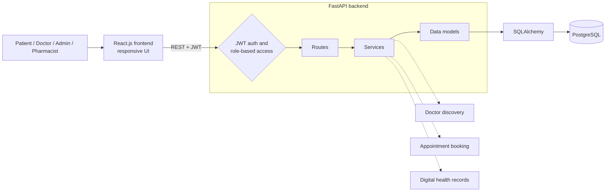

 

---

## 👋 About Me

I'm **Mannala Abiram**, a B.Tech Computer Science graduate (2026) who builds **LLM applications, RAG pipelines and tool-calling agents**, and wraps them in real **FastAPI backends and React frontends**. I care about the full path from raw documents to a working product: ingestion, retrieval, orchestration, API, UI and measurement.

- 🔭 **Built:** [InsightAI](https://github.com/mannalaabiram2005-art/InsightAI), an agentic RAG app with persistent multi-turn memory, and [AI Resume Shortlister](https://github.com/mannalaabiram2005-art/AI_RESUME_SHORTLISTER), a semantic resume-ranking engine.
- 🌱 **Learning next:** Model Context Protocol (MCP), RAG evaluation (RAGAS, DeepEval), multi-agent patterns, pgvector and Docker-based deployment.
- 🎯 **Looking for:** AI Engineer, LLM Application Developer, Generative AI Engineer and internship roles.
- 💬 **Ask me about:** RAG pipelines, chunking and retrieval tuning, LangChain agents, vector search, FastAPI backend design.
- 📫 **Reach me:** [abirammannala@gmail.com](mailto:abirammannala@gmail.com) · [LinkedIn](https://www.linkedin.com/in/abirammannala)

---

## 📊 Results at a Glance

| Project | Measured outcome |
|---|---|
| 🤖 **InsightAI** | Answer accuracy raised **90% → 95%** on an internal test set by tuning chunk size and top-5 retrieval; **~2 s** average response across 20 documents |
| 🧾 **AI Resume Shortlister** | **200 resumes screened in 65 s** (vs. an estimated 2–3 hours manually); **80%** agreement with manual shortlisting; **95%** extraction accuracy |
| 🏥 **MediQ** | **5 REST endpoints** load-tested with **500 concurrent users** at **~1 s** average response; JWT auth with **4 user roles** |

Figures come from my own test sets and samples (internal test set, 200 labeled resumes, load test), as described in each project README and on my resume.

---

## 🚀 Featured Projects

### 🤖 [InsightAI](https://github.com/mannalaabiram2005-art/InsightAI) — Full-Stack Agentic RAG Application
Multi-turn question answering over uploaded **PDF, TXT and Markdown** files. A LangChain agent decides between **document retrieval** and **real-time web search**, then returns grounded answers with Llama 3.1 running on Groq.

`Python` `LangChain` `FastAPI` `Groq (Llama 3.1)` `ChromaDB` `Hugging Face Embeddings` `SQLAlchemy` `SQLite` `React` `Vite` `Tailwind CSS`

- Ingestion and retrieval pipeline with a persistent vector store; chunk size and top-k tuned to lift accuracy from 90% to 95%.
- Persistent chat memory (SQLite + SQLAlchemy) for context-aware conversations across sessions.
- React + Vite + Tailwind interface built end to end.

### 🧾 [AI Resume Shortlister](https://github.com/mannalaabiram2005-art/AI_RESUME_SHORTLISTER) — Recruitment Automation
Parses bulk PDF resumes and ranks candidates against a job description with **Sentence Transformers embeddings and FAISS similarity search**, using a configurable relevance threshold.

`Python` `LangChain` `Sentence Transformers` `FAISS` `FastAPI` `Streamlit`

- Extracts names, emails, phone numbers and skills into structured, recruiter-ready results.
- Streamlit dashboard and FastAPI endpoints to view ranked candidates and screening output.

### 🏥 [MediQ](https://github.com/mannalaabiram2005-art/Smart_Appointment) — Full-Stack Healthcare Management System
Doctor discovery, appointment booking and digital health records with a responsive React interface.

`React.js` `FastAPI` `PostgreSQL` `SQLAlchemy` `JWT`

- JWT authentication and role-based authorization for patients, doctors, administrators and pharmacists.
- Backend structured into routes, services and data-model layers for maintainability.

### 🌐 [Portfolio](https://abi-portfolio-smb5.vercel.app/)
Responsive personal site with project case studies, deployed on Vercel.

---

## 🧠 What I Work On

| Area | What I've actually built with |
|---|---|
| 🔎 **RAG** | Document parsing, chunking, embeddings, top-k retrieval tuning, grounded answers |
| 🤖 **Agents** | ReAct-style tool-calling agents (LangChain) that route between retrieval and web search |
| 🗂️ **Vector search** | FAISS, ChromaDB |
| ⚙️ **Backend** | FastAPI, REST API design, JWT auth, SQLAlchemy, PostgreSQL, SQLite |
| 🖥️ **Frontend** | React, Vite, Tailwind CSS, Streamlit |
| 🧾 **Applied NLP** | Resume parsing, entity extraction, semantic ranking |

---

## 🛠️ Tech Stack

<table>
<tr>
<td><b>Languages</b></td>
<td>
&nbsp;
&nbsp;
&nbsp;
</td>
</tr>
<tr>
<td><b>LLM &amp; AI</b></td>
<td>
&nbsp;
&nbsp;
&nbsp;
</td>
</tr>
<tr>
<td><b>Backend &amp; APIs</b></td>
<td>
&nbsp;
&nbsp;
&nbsp;
</td>
</tr>
<tr>
<td><b>Frontend</b></td>
<td>
&nbsp;
&nbsp;
&nbsp;
&nbsp;
</td>
</tr>
<tr>
<td><b>Data &amp; Vector DBs</b></td>
<td>
&nbsp;
&nbsp;
&nbsp;
&nbsp;
</td>
</tr>
<tr>
<td><b>Tools</b></td>
<td>
&nbsp;
&nbsp;
&nbsp;
&nbsp;
&nbsp;
</td>
</tr>
</table>

**Also:** Groq (Llama 3.1) · Sentence Transformers · FAISS · ChromaDB · SQLAlchemy · Prompt Engineering · Conversational Memory

---

## 📈 GitHub Activity

---

## 🎓 Education & Learning

**B.Tech, Computer Science** — Anantha Lakshmi Institute of Technology & Sciences, JNTU Anantapur (2026)
**Certifications:** Artificial Intelligence Fundamentals (IBM) · Data Analysis & Decision Making (NPTEL)

**Learning roadmap**

- [x] LangChain agents and tool calling
- [x] FAISS and ChromaDB vector search
- [x] FastAPI backends with JWT auth
- [ ] LangGraph state machines
- [ ] Model Context Protocol (MCP) integrations
- [ ] LLM evaluation (RAGAS, DeepEval)
- [ ] Multi-agent orchestration
- [ ] pgvector and Docker-based AI service deployment

## 🎯 2026 Goals

- 📌 Join a team as an AI Engineer / LLM Application Developer
- 📌 Add an evaluation harness (RAGAS) to InsightAI and publish the results
- 📌 Write up lessons from tuning RAG retrieval
- 📌 Contribute to an open-source RAG or agent project

---

## 🤝 Let's Connect

⭐ If my work is useful or interesting, a star on the repos is appreciated. Thanks for visiting!

